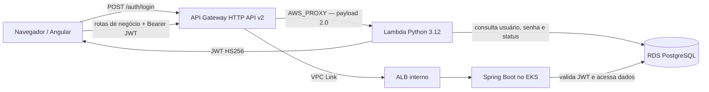

# Lambda de autenticação do AutoFlow

Este repositório mantém a função AWS Lambda em Python 3.12 que autentica usuários por CPF/CNPJ e emite JWT HS256. A
função consulta o RDS PostgreSQL; o backend Spring Boot valida o token e aplica autorização nas rotas de negócio.

## Papel na arquitetura

`autoflow-infra` gerencia a Amazon API Gateway HTTP API v2, sua integração `AWS_PROXY` e a permissão de invocação da
Lambda. O Terraform deste repositório gerencia a função e sua execução em rede privada.



A função normaliza e valida CPF/CNPJ, verifica a senha com BCrypt e consulta o usuário no PostgreSQL. Para o perfil
`CLIENTE`, também exige cliente ativo. O backend revalida assinatura e claims e carrega o perfil atual do banco; a HTTP API
não atua como JWT authorizer.

O contrato e exemplos estão no [guia OpenAPI](https://github.com/autoflow-fiap/autoflow/blob/develop/docs/openapi/README.md)
e na [coleção Postman de autenticação](https://github.com/autoflow-fiap/autoflow/blob/develop/backend/postman/autoflow-serverless-auth.postman_collection.json).
O README de [integração com API Gateway](docs/api-gateway.md) e o [catálogo de Variables e Secrets](docs/variables-and-secrets.md)
detalham a configuração.

## Validar e empacotar localmente

Requer Python 3.12, Terraform 1.16.5 e Bash (Git Bash ou WSL para o build do pacote):

```bash
python -m pip install -r requirements.txt
python -m unittest test_handler test_http_api -v
python -m unittest discover -s scripts -p 'test_*.py' -v
bash build.sh
terraform -chdir=infra init -backend=false -input=false
terraform -chdir=infra validate
```

`build.sh` gera o pacote ZIP; Dockerfile não se aplica a este runtime Lambda. Os comandos Terraform acima não usam backend
remoto nem acessam a AWS.

## CI/CD e ambientes

- `ci.yml` executa testes Python, auditoria de dependências, build do pacote e validação Terraform em PRs para
  `develop`/`main` e pushes para `develop`, `main` e `feature/**`.
- `pr-automatico.yaml` cria Pull Request para `develop` após push, exceto em `develop`, `main` e `feat/production-dedicated`.
- `pipeline.yml` recebe `push` e `workflow_dispatch` em `develop`/`main`. O caminho automático exige a Repository Variable
  correspondente (`AUTO_CD_ENABLED_HOMOLOG` ou `AUTO_CD_ENABLED_PRODUCTION`) igual a `true` e sucesso de `Lambda CI` para
  o mesmo SHA.
- Cada Plan publica um pacote Lambda imutável no S3 antes de gerar o Terraform Plan; isso inclui o caminho automático e
  o dispatch Plan-only (`apply=false`). Esse passo não aplica Terraform nem atualiza a função.
- Apply requer `workflow_dispatch` com `apply=true`, `TERRAFORM_APPLY_APPROVAL_CONFIGURED=true` e validação do Plan.
  `develop` seleciona `homolog`; `main` seleciona `production` e exige branch protegida. O job usa o Environment
  selecionado; configure Required reviewers e restrições de branch para proteger o deployment.
- Configure proteção de branch em `develop` e `main` para exigir Pull Request e checks de CI.

O fluxo depende dos States de VPC/EKS e RDS do mesmo ambiente, do bucket S3 configurado e da role de execução Lambda. A
API Gateway é provisionada pelo root correspondente em `autoflow-infra`, na sequência descrita no
[runbook de implantação](https://github.com/autoflow-fiap/autoflow-infra/blob/develop/docs/api-gateway/runbook.md).
