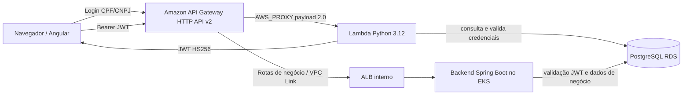

# Lambda de autenticação do AutoFlow

Este repositório mantém a função serverless Python 3.12 que autentica clientes pelo PostgreSQL e emite JWT HS256. O fluxo final é **Frontend Angular → Amazon API Gateway HTTP API → integração AWS_PROXY → Lambda → RDS PostgreSQL**. O backend Spring Boot valida o JWT nas rotas protegidas. Após reset do AWS Academy Learner Lab, reexecute as pipelines CI/CD para provisionar novamente os recursos.

O repositório `autoflow-infra` gerencia a integração nativa e a permissão `lambda:InvokeFunction` restrita à rota de login. O Terraform deste repositório gerencia a função e sua configuração de execução. A Function URL não faz parte do fluxo de autenticação configurado.

## Fluxo de autenticação CPF/JWT

O API Gateway HTTP API v2 encaminha a solicitação de login à Lambda por integração `AWS_PROXY`. A função valida o CPF/CNPJ, consulta usuário e cliente no PostgreSQL, verifica a senha com BCrypt e emite um JWT HS256. Para o perfil `CLIENTE`, o cliente associado precisa estar ativo. O backend Spring Boot valida assinatura e claims e carrega o perfil atual antes de autorizar rotas protegidas.



Os corpos, respostas, status HTTP e exemplos de requisição são mantidos no [guia central OpenAPI](https://github.com/autoflow-fiap/autoflow/blob/develop/docs/openapi/README.md) e na [coleção Postman de autenticação CPF/JWT](https://github.com/autoflow-fiap/autoflow/blob/develop/backend/postman/autoflow-serverless-auth.postman_collection.json); este README não duplica o contrato. `JWT_SECRET` precisa corresponder entre Lambda e backend.

O API Gateway e a permissão de invocação são mantidos em `autoflow-infra`; esta função conecta-se ao RDS privado. Após reset do Learner Lab, execute novamente as pipelines CI/CD na ordem de dependências para provisionar o fluxo completo.

## Terraform e segurança

`infra/lambda.tf` declara a função em subnets privadas, Security Group do RDS, timeout de 15 segundos e memória de 256 MB. A role de execução é fornecida externamente. O ZIP é publicado no bucket S3 configurado sob `lambda-packages/sha256/`, com escrita condicional, versionamento e checksum; o Terraform usa bucket, chave e `VersionId` aprovados no Plan. O prefixo dos pacotes não coincide com as keys dos Terraform States. A identidade e a configuração de runtime da função permanecem gerenciadas pelo mesmo recurso Terraform.

## Pipeline e ambientes

Consulte o [catálogo de variables e secrets](docs/variables-and-secrets.md) e o [histórico](docs/variables-changelog.md) para configuração do GitHub Actions, Terraform e runtime.

O workflow usa o mesmo root Terraform para os dois ambientes:

- `develop` seleciona o GitHub Environment `homolog` e mantém a função `autoflow-cpf-validator-homolog`.
- `main` seleciona o Environment `production` e cria/atualiza `autoflow-cpf-validator-production`.
- Push em uma dessas branches executa Plan e Apply para o ambiente correspondente; ambos usam o Environment da branch, e os Required reviewers configurados nele são gates obrigatórios. O Apply preserva os guards contra Destroy, Replace e mudança de identidade da Lambda.
- Pull Requests e pushes em `feature/**` executam somente CI estático. `workflow_dispatch` só habilita Plan/Apply quando executado em `develop` ou `main`.

Configure os Environments `homolog` e `production`, restringindo deployments respectivamente a `develop` e `main`. Em cada um, cadastre suas próprias Variables e Secrets, incluindo `TF_PLAN_ENCRYPTION_KEY`, habilite Required reviewers e defina `TERRAFORM_APPLY_APPROVAL_CONFIGURED=true` somente depois de confirmar a regra. Os nomes necessários e as chaves de State estão em [variables-and-secrets.md](docs/variables-and-secrets.md). Credenciais AWS temporárias, dados PostgreSQL, JWT Secret, chave de criptografia e role Lambda são fornecidos externamente; não use valores de um ambiente no outro.

Configure também a proteção da branch `main` com Pull Request obrigatório e checks de CI requeridos antes de promovê-la. Os jobs de Plan/Apply production exigem `github.ref_protected`; a configuração externa de rulesets continua manual. A proteção do Environment controla os deployments e não substitui a proteção da branch.

O bucket de pacotes Lambda reutiliza `AWS_TERRAFORM_STATE_BUCKET`, mas o prefixo `lambda-packages/sha256/` é separado das keys dos states. Antes de habilitar o deploy, prepare os states de VPC/EKS e RDS do mesmo ambiente, no bucket pertencente à conta indicada por `AWS_EXPECTED_ACCOUNT_ID`. Na mesma conta, homolog e produção podem compartilhar bucket, mas usam keys diferentes. Em contas diferentes, cada Environment usa seu próprio bucket e states.

As keys de Terraform State vêm das Variables de cada Environment: devem iniciar pelo nome do Environment e ser distintas entre os roots no mesmo bucket. As relações exatas entre a key de VPC/EKS, RDS, Lambda e aplicação estão em [variables-and-secrets.md](docs/variables-and-secrets.md); os sufixos não são fixados pelo código.

```bash
# Pré-requisito: Python 3.12
python -m pip install -r requirements.txt
python -m unittest test_handler test_http_api -v
python -m unittest discover -s scripts -p 'test_*.py' -v
```

Para criar localmente o pacote de deploy determinístico, use Docker e Bash (por exemplo, Git Bash ou WSL):

```bash
bash build.sh
```

O pipeline publica o pacote e executa Terraform somente para `develop`/`homolog` ou `main` protegida/`production`. O Plan é criptografado antes de ser publicado como artifact por um dia; o Apply aprovado confere integridade, run, commit e fingerprint antes de descriptografá-lo. Para uma execução manual, selecione uma dessas branches no workflow; o mesmo Environment, preflight de conta e gates de aprovação continuam obrigatórios. Mudanças em PR e branches feature não recebem credenciais AWS e não executam Plan/Apply.

`AWS_EXPECTED_ACCOUNT_ID`, fornecido pelas variables externas do ambiente, é transformado em
`TF_VAR_aws_allowed_account_ids` e restringe o backend S3 e os dois `terraform_remote_state` (VPC/EKS e RDS). O `init`
remoto mantém `encrypt=true` e `use_lockfile=true`; as verificações STS e de existência dos states precedem
Plan/Apply. Para uma inicialização remota autorizada, use a conta e as keys configuradas externamente:

```bash
terraform -chdir=infra init -input=false -reconfigure \
  -backend-config="bucket=$AWS_TERRAFORM_STATE_BUCKET" \
  -backend-config="key=$AWS_TF_STATE_KEY" \
  -backend-config="region=$AWS_REGION" \
  -backend-config="allowed_account_ids=$TF_VAR_aws_allowed_account_ids" \
  -backend-config="encrypt=true" \
  -backend-config="use_lockfile=true"
```

Para validar o Terraform sem inicializar o backend remoto:

```bash
cd infra
terraform init -backend=false -input=false
terraform validate
python -m unittest discover -s scripts -p 'test_terraform_backend_config.py' -v
```

O Terraform valida a conta configurada contra STS, verifica o owner do bucket e consome somente os states remotos definidos para a mesma conta e ambiente. Plan e Apply validam o prefixo, unicidade e fingerprint das keys selecionadas. Não aponte uma key nova vazia para um root existente sem reconciliação ou migração controlada; o estado local deste repositório não comprova a localização atual dos States remotos. A troca de credenciais/conta ocorre nas configurações externas dos Environments, sem IDs ou ARNs de conta versionados. O fluxo CPF/CNPJ, as validações de status e a emissão JWT permanecem os mesmos; `JWT_SECRET` deve coincidir com `AUTOFLOW_JWT_SECRET` da aplicação dentro de cada ambiente.
