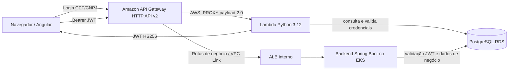

# Lambda de autenticação do AutoFlow

Este repositório mantém a função serverless Python 3.12 que autentica clientes pelo PostgreSQL e emite JWT HS256. O fluxo final é **Frontend Angular → Amazon API Gateway HTTP API → integração AWS_PROXY → Lambda → RDS PostgreSQL**. O backend Spring Boot valida o JWT nas rotas protegidas. Após reset do AWS Academy Learner Lab, reexecute as pipelines CI/CD para provisionar novamente os recursos.

O repositório `autoflow-infra` gerencia a integração nativa e a permissão `lambda:InvokeFunction` restrita à rota de login. O Terraform deste repositório gerencia a função e sua configuração de execução. A Function URL não faz parte do fluxo de autenticação configurado.

## Fluxo de autenticação CPF/JWT

O API Gateway HTTP API v2 encaminha a solicitação de login à Lambda por integração `AWS_PROXY`. A função valida o CPF/CNPJ, consulta usuário e cliente no PostgreSQL, verifica a senha com BCrypt e emite um JWT HS256. Para o perfil `CLIENTE`, o cliente associado precisa estar ativo. O backend Spring Boot valida assinatura e claims e carrega o perfil atual antes de autorizar rotas protegidas.



Os corpos, respostas, status HTTP e exemplos de requisição são mantidos no [guia central OpenAPI](https://github.com/autoflow-fiap/autoflow/blob/develop/docs/openapi/README.md) e na [coleção Postman de autenticação CPF/JWT](https://github.com/autoflow-fiap/autoflow/blob/develop/backend/postman/autoflow-serverless-auth.postman_collection.json); este README não duplica o contrato. `JWT_SECRET` precisa corresponder entre Lambda e backend.

O API Gateway e a permissão de invocação são mantidos em `autoflow-infra`; esta função conecta-se ao RDS privado. Após reset do Learner Lab, execute novamente as pipelines CI/CD na ordem de dependências para provisionar o fluxo completo.

## Terraform e segurança

`infra/lambda.tf` declara a função em subnets privadas, Security Group do RDS, timeout de 15 segundos e memória de 256 MB. A role de execução é fornecida externamente. O ZIP é publicado no bucket S3 configurado sob `lambda-packages/sha256/`, com escrita condicional, versionamento e checksum; o Terraform usa bucket, chave e `VersionId` aprovados no Plan. O prefixo dos pacotes não coincide com as keys dos Terraform States. A identidade e a configuração de runtime da função permanecem gerenciadas pelo mesmo recurso Terraform.

## Pipeline e validação

Consulte o [catálogo de variables e secrets](docs/variables-and-secrets.md) e o [histórico](docs/variables-changelog.md) para configuração do GitHub Actions, Terraform e runtime.

CI executa em Pull Requests e pushes para `develop` e `main`, com testes Python, auditoria de dependências e validação Terraform. O workflow de `develop` executa Plan/Apply no Environment `homolog`, respeitando os gates definidos. Não há Apply em PR nem CD de produção. Após reset do Learner Lab, reexecute as pipelines CI/CD para provisionar novamente os recursos.

Configure como repository secrets os secrets `AWS_ACCESS_KEY_ID`, `AWS_SECRET_ACCESS_KEY`, `AWS_SESSION_TOKEN`, `DATABASE_USERNAME`, `DATABASE_PASSWORD` e `JWT_SECRET`; como repository variables `AWS_REGION`, `AWS_EXPECTED_ACCOUNT_ID`, `AWS_TERRAFORM_STATE_BUCKET`, `AWS_TF_STATE_KEY`, `AWS_INFRA_STATE_KEY`, `AWS_RDS_STATE_KEY` e `AWS_LAMBDA_EXECUTION_ROLE_ARN`; e como Environment variable `homolog`, `TERRAFORM_APPLY_APPROVAL_CONFIGURED=true`. O bucket de pacotes Lambda reutiliza `AWS_TERRAFORM_STATE_BUCKET`. Configure Required reviewers no Environment `homolog`. Os valores esperados estão documentados em [variables-and-secrets.md](docs/variables-and-secrets.md); não copie valores sensíveis para documentação.

```bash
# Pré-requisito: Python 3.12
python -m pip install -r requirements.txt
python -m unittest discover -s . -p "test_*.py" -v
```

Para criar localmente o pacote de deploy determinístico, use Docker e Bash (por exemplo, Git Bash ou WSL):

```bash
bash build.sh
```

O pipeline publica o pacote e executa Terraform para homologação. Para solicitar a execução manual, selecione a branch `develop` no workflow `Pipeline` e use `workflow_dispatch`; revise o Plan e o gate do Environment `homolog` antes de qualquer Apply. Após reset do Learner Lab, reexecute as pipelines CI/CD correspondentes para provisionar novamente o ambiente.

`AWS_EXPECTED_ACCOUNT_ID`, fornecido pelas variables externas do ambiente, é transformado em
`TF_VAR_aws_allowed_account_ids` e restringe o backend S3 e os dois `terraform_remote_state` (VPC/EKS e RDS). O `init`
remoto mantém `encrypt=true` e `use_lockfile=true`; as verificações STS e de existência dos states precedem
Plan/Apply. Para uma inicialização remota autorizada, use a conta e as keys configuradas externamente:

```bash
terraform -chdir=infra init -input=false -reconfigure \
  -backend-config="bucket=$AWS_TERRAFORM_STATE_BUCKET" \
  -backend-config="key=$AWS_TF_STATE_KEY" \
  -backend-config="region=$AWS_REGION" \
  -backend-config="allowed_account_ids=$TF_VAR_aws_allowed_account_ids" \
  -backend-config="encrypt=true" \
  -backend-config="use_lockfile=true"
```

Para validar o Terraform sem inicializar o backend remoto:

```bash
cd infra
terraform init -backend=false -input=false
terraform validate
python -m unittest discover -s scripts -p 'test_terraform_backend_config.py' -v
```

O state S3 e os states remotos consumidos devem ser os autorizados para a conta e ambiente esperados. Não aplique planos que incluam alteração de código Lambda durante o fechamento da URL.
