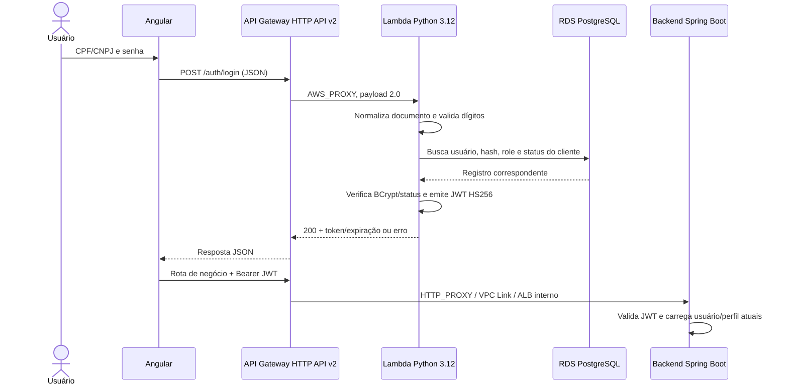

# RFC-001 — Autenticação serverless e emissão de JWT

- **Título:** RFC-001 — Autenticação serverless e emissão de JWT
- **Status:** implementada na configuração versionada; implantação/estado atual da AWS não verificados.
- **Data:** 02/11/2026.
- **ADR relacionada:** [ADR-001 — Autenticação serverless e JWT](../adr/ADR-001-autenticacao-serverless-jwt.md).

## 1. Contexto e problema

### Síntese executiva

O root `autoflow-lambda` declara uma função Python 3.12 na VPC, conectada ao RDS PostgreSQL, que autentica CPF/CNPJ e senha e emite JWT HS256. `autoflow-infra` declara a HTTP API v2, a rota `POST /auth/login`, a integração Lambda `AWS_PROXY` e a permissão de invocação. O backend Spring Boot valida o JWT e aplica autorização de domínio. Essa separação aparece no código/configuração versionados; não comprova implantação, tráfego ou configuração atual da conta AWS.

### Problema e motivação observável

O fluxo exige autenticar credenciais persistidas no banco e entregar ao frontend uma credencial que possa ser verificada pelo backend. A Lambda implementa essa fronteira sem ser responsável pela autorização de cada operação de negócio. O mecanismo escolhido precisa preservar compatibilidade de claims e segredo entre Python/PyJWT e Java, além de manter a consulta ao estado do cliente.

Não foi localizado ADR/RFC anterior que registre a motivação original, aprovadores ou comparação formal. Esta RFC descreve a implementação existente e uma análise retrospectiva; não atribui intenção histórica nem resultados de custo/performance que não estejam registrados.

### Objetivos e não objetivos

**Objetivos:** documentar o contrato da função, integração com API Gateway, persistência usada para autenticação, claims JWT, validação no backend, ownership entre repositórios, riscos de segurança e critérios de verificação.

**Não objetivos:** mudar o login, o algoritmo, as claims ou o tempo de validade; criar JWT/Lambda Authorizer no API Gateway; mover rotas para este root; alterar a autorização do backend, schema, infraestrutura, pipeline ou recursos AWS; declarar que recursos estão implantados.

### Requisitos e restrições

- API Gateway HTTP API v2 chama a Lambda via `AWS_PROXY`, payload 2.0, na rota explícita `POST /auth/login`.
- A permissão `lambda:InvokeFunction` pertence ao root `autoflow-infra`; a Function URL não faz parte do fluxo configurado.
- O handler valida documento e corpo, consulta usuário/cliente no PostgreSQL e compara senha com BCrypt.
- JWT usa HS256 e `JWT_SECRET` compartilhado com o backend; duração configurável tem default de 3600 segundos.
- Backend valida assinatura/expiração, recarrega usuário e perfil/estado e aplica autorização. API Gateway não tem authorizer JWT declarado.
- A função declara timeout de 15 segundos, memória de 256 MB e VPC config. A consulta cria e fecha conexão PostgreSQL a cada busca.
- Conta, State, credenciais e valores de ambiente são externos e não devem ser inferidos nem expostos nesta RFC.

## 2. Proposta e solução observada

### Diagrama e fronteiras

`autoflow-lambda` provisiona a função e seu runtime. `autoflow-infra/infra/api-gateway` provisiona API, rota, integração e permissão de invocação. `autoflow` mantém o backend, filtro JWT e autorização Spring/domínio. O fluxo frontend, rotas e integração privada estão descritos na [arquitetura do gateway](https://github.com/autoflow-fiap/autoflow-infra/blob/develop/docs/api-gateway/arquitetura.md).

### Contrato atual do handler

1. O handler lê o corpo do evento HTTP, inclusive `isBase64Encoded`, e exige objeto JSON.
2. Normaliza CPF/CNPJ para dígitos e valida formato e dígitos verificadores; entradas inválidas retornam 400.
3. Consulta `usuarios` e `clientes`, comparando documentos normalizados com `regexp_replace`.
4. Compara a senha informada com o hash armazenado usando `bcrypt.checkpw`.
5. Credenciais inválidas retornam 401; para `CLIENTE`, status diferente de `ATIVO` também impede emissão.
6. JWT HS256 contém `sub` com CPF/CNPJ normalizado, `role`, `iat`, `exp` e email quando disponível. A resposta inclui `token`, `tokenType: Bearer` e `expiresIn`.
7. Falha PostgreSQL e falha inesperada retornam 500 com mensagem estática. Os logs do handler registram somente o tipo da exceção, sem sua mensagem.

O token é assinado, não criptografado. A Lambda e o backend compartilham o mesmo segredo HS256. O backend não deve tomar o claim `role` como autorização final: ele valida o JWT e consulta estado atual antes de aplicar regras Spring/domínio. Não foi encontrada revogação explícita por token.

### Runtime e Terraform

O root Terraform declara `python3.12`, handler `handler.lambda_handler`, 15 segundos de timeout, 256 MB, subnets privadas, Security Group consumido do State RDS e variáveis de ambiente `DB_HOST`, `DB_PORT`, `DB_NAME`, `DB_USERNAME`, `DB_PASSWORD`, `JWT_SECRET` e `JWT_EXPIRES_IN_SECONDS`. O default de expiração no Terraform e no handler é 3600 segundos. O `connect_timeout` PostgreSQL do código é cinco segundos.

Os inputs de banco e JWT são marcados `sensitive` no Terraform, mas a marcação evita exibição em determinadas saídas e não retira valores do Terraform State nem do runtime. O State e os Plans requerem controle de acesso apropriado; a configuração AWS/conta não foi consultada nesta revisão.

## 3. Alternativas consideradas

Não há comparação histórica formal ou benchmark. A análise abaixo explicita mecanismos e consequências para o código atual.

| Alternativa | Vantagem possível | Trade-off / impacto | Razão para não ser a implementação declarada |
|---|---|---|---|
| Lambda de login com HS256 (atual) | Separa o endpoint de login; consulta status persistido antes da emissão; token já é aceito pelo backend. | Segredo simétrico compartilhado, claims pessoais, conexão ao RDS por busca e coordenação de rotação; dependência de Lambda, VPC e RDS. | É o comportamento/configuração versionados; não se alega superioridade de custo ou latência. |
| Autenticação no backend Spring Boot | Reutiliza security, acesso a banco e runtime do backend, com menos um caminho de emissão. | Remove o fluxo serverless atual e acopla login à disponibilidade/deploy do backend; requer alteração coordenada da rota e do consumidor. | Não é integração configurada para a rota de login atual. |
| IdP gerenciado, como Cognito | Delegaria ciclo de credenciais e emissão de token a um provedor de identidade. | Migração/associação de usuários e hashes existentes, mapeamento CPF/CNPJ/roles, integração frontend/backend, nova política de identidade e custo dependente do uso/plano. | Não há IdP configurado nem plano/versionamento de migração de credenciais. |
| JWT Authorizer nativo da HTTP API | Validaria issuer/JWKS/claims antes de encaminhar a rota ao backend, evitando que tokens inválidos cheguem à integração. | O token atual é HS256 e não declara `iss`/`aud`; adoção requer compatibilidade de algoritmo/claims e coordenação com o backend. Não consulta RDS nem decide status/perfil atual. | Não está declarado. Backend faz validação final e a rota HTTP API atual não configura authorizer. |
| Lambda Authorizer para o HS256 atual | Pode executar validação customizada antes da integração privada e manter compatibilidade com o secret simétrico. | Adiciona execução, permissão, secret access, eventual cache e outro código criptográfico; duplica validação sem substituir autorização no backend. | Não há authorizer configurado. Adotá-lo exige análise de custo/latência e revisão de ownership no root API Gateway. |
| Assinatura assimétrica com JWKS | Permite separar chave privada de assinatura da chave pública de validação e pode habilitar validação nativa por issuer/JWKS. | Muda algoritmo/claims/configuração e exige migração coordenada, período de compatibilidade, armazenamento de chave privada e testes entre PyJWT e Java. | É melhoria futura possível, não parte da configuração nem dos objetivos desta RFC. |

## 4. Impactos e riscos

**Componentes afetados:** Lambda Python, role e Security Group, RDS e seu State, API Gateway HTTP API/route permission, frontend e backend JWT. Alterar schema afeta migrations Flyway no repositório `autoflow`, não este root.

**Contrato:** `POST /auth/login` recebe JSON `cpf_cnpj` e `senha`; sucesso retorna JWT Bearer e expiração. O frontend e backend devem manter claims e assinatura compatíveis. Erros de formato, credenciais, status do cliente e falha de banco têm classes HTTP diferentes; mudanças precisam de testes de contrato.

**Segurança e privacidade:** CPF/CNPJ aparece no `sub`, email pode aparecer como claim e o token não cifra esses valores. Senha é recebida no evento e verificada com BCrypt; logs observados não imprimem o conteúdo da exceção. Secret de banco e JWT são configurados na função; `sensitive` não protege o valor contra leitura autorizada do State ou da configuração Lambda. A função não declara authorizer de negócio nem revogação de token.

**Performance/disponibilidade:** cada autenticação consulta RDS e abre uma conexão nova. O timeout de conexão de cinco segundos está dentro do limite Lambda de 15 segundos; cold starts, concorrência, limite de conexões e latência dependem de runtime/conta e não foram medidos. Uma indisponibilidade de RDS resulta em falha de login.

**Custos/manutenção:** custo depende de invocações, duração/memória, rede, RDS, logs e serviço API Gateway; não há comparação de custo ou benchmark nesta RFC. Há responsabilidades entre três roots/repositórios e a rotação do segredo compartilhado deve ser coordenada.

| Risco | Mitigação observada ou ação futura |
|---|---|
| Brute force/abuso do endpoint de login | API Gateway declara throttling mais restritivo para login; validar configuração e métricas no ambiente. O limite no Terraform não comprova proteção aplicada. |
| CPF/CNPJ/email expostos em JWT ou logs | Não registrar token/corpo; minimizar claims numa mudança compatível e revisar logs/access logs. JWT atual não é criptografado. |
| Secret HS256 comprometido ou rotação parcial | Restringir acesso a Secrets/State/Plan/configuração; coordenar mudança nos dois consumers. Avaliar chaves assimétricas/JWKS como projeto separado. |
| Token permanece utilizável após emissão | Backend recarrega usuário/perfil/status; não foi encontrada revogação explícita. Definir futuro mecanismo de revogação ou expiração menor com análise de impactos. |
| Conexões simultâneas excedem capacidade do RDS | Medir conexão/latência e limites no ambiente; avaliar RDS Proxy ou reuso controlado em trabalho futuro, não presumido como configurado. |
| Secret armazenado em State/Plan | Proteger bucket, IAM, versionamento, logs e artefatos; auditar acesso e política de rotação fora desta revisão. |
| Erro interno revela dado | Handler retorna mensagens estáticas e registra classe/tipo, não texto da exceção; manter teste de não exposição ao alterar tratamento. |

## 5. Plano de implementação, rollout e recuperação

A função, integração e validações descritas já aparecem em configuração versionada; esta RFC não autoriza nem afirma novo deploy.

1. Validar contrato no OpenAPI/Postman, handler e filtro JWT do backend antes de qualquer alteração.
2. Executar testes locais da Lambda e inspeção/validação Terraform sem backend remoto.
3. Para mudanças autorizadas, manter login API Gateway → Lambda e verificar permissão restrita à rota; não criar Function URL pública inadvertidamente.
4. Revisar Plan da Lambda e API Gateway nos roots proprietários, States/Environment e dependências RDS/VPC antes de Apply autorizado.
5. Em homologação, usar dados sintéticos e verificar sucesso, falha de credencial, cliente inativo, JWT válido/expirado/alterado, autorização de backend e sanitização de logs.
6. Promover com segredo compatível entre Lambda e backend; mudança de algoritmo/claims/secret exige plano de rotação e janela compatível próprios.

Se a função ou o segredo falhar, interromper promoção, identificar versão do pacote/Plan e configuração dos dois consumers; não registrar nem copiar segredo/token para logs. Recuperação requer artefato e configuração compatíveis e aprovação do ambiente. Não executar alterações de AWS nesta tarefa.

## 6. Critérios de aceite e métricas

| ID | Critério | Método esperado | Evidência |
|---|---|---|---|
| CA-01 | Corpo e CPF/CNPJ inválidos não geram token | Testes do handler para JSON inválido, documentos inválidos e senha ausente; respostas 400 | `test_handler.py`, `test_http_api.py` |
| CA-02 | Credencial errada/inexistente e cliente não ativo são rejeitados | Testes para usuário ausente, BCrypt negativo, status cliente inativo e resposta sem token | `test_handler.py` |
| CA-03 | JWT tem contrato compatível | Decodificar teste HS256 e verificar `sub`, `role`, `iat`, `exp`, email opcional e prazo configurável | `test_handler.py`, `handler.py` |
| CA-04 | Handler segue o evento HTTP API v2 e erros não expõem exceções | Testar JSON/base64, status/body e log sem mensagem/segredo/credencial | `test_http_api.py`, `test_handler.py` |
| CA-05 | Invocação está limitada ao API Gateway e rota esperada | Inspecionar `aws_lambda_permission`/route no root dono do gateway; não deve haver Function URL pública | `autoflow-infra/infra/api-gateway/` e `docs/api-gateway.md` |
| CA-06 | Backend revalida token e autorização | Testar token válido/inválido/expirado, usuário/perfil/status atuais e regras Spring | `JwtFilter`, `JwtService`, testes backend |
| CA-07 | Secrets e State são protegidos | Revisar Environment, IAM, bucket/State/Plan e acesso à configuração Lambda | `variables-and-secrets.md`, workflow e Terraform |
| CA-08 | Runtime/integração Terraform são válidos | `terraform fmt -check`, `init -backend=false`, `validate`; testes locais não acessam AWS | `infra/`, CI |
| CA-09 | Operação de banco suporta concorrência planejada | Medir conexões, duração e falhas em ambiente aprovado; definir capacidade/limite e se RDS Proxy é necessário | Métricas RDS/Lambda externas |

Não há valores medidos de latência, taxa de erro, custo, cold start ou conexões concorrentes. Expiração de 3600 segundos, timeout e throttling são parâmetros configurados, não métricas de resultado.

## Referências

- [ADR-001 — Autenticação serverless e JWT](../adr/ADR-001-autenticacao-serverless-jwt.md)
- [README da Lambda](../../README.md) e [integração com API Gateway](../api-gateway.md)
- [Handler](../../handler.py), [testes unitários](../../test_handler.py) e [testes de evento HTTP](../../test_http_api.py)
- [Terraform Lambda](../../infra/lambda.tf), [inputs](../../infra/variables.tf) e [documentação de Secrets/State](../variables-and-secrets.md)
- [Arquitetura API Gateway vigente](https://github.com/autoflow-fiap/autoflow-infra/blob/develop/docs/api-gateway/arquitetura.md)
- [RFC do API Gateway](https://github.com/autoflow-fiap/autoflow-infra/blob/develop/docs/api-gateway/rfc-api-gateway.md)
- [Filtro e serviço JWT do backend](https://github.com/autoflow-fiap/autoflow/tree/develop/backend/src/main/java/com/autoflow/infrastructure/security)
- [Contrato OpenAPI](https://github.com/autoflow-fiap/autoflow/blob/develop/docs/openapi/README.md)
